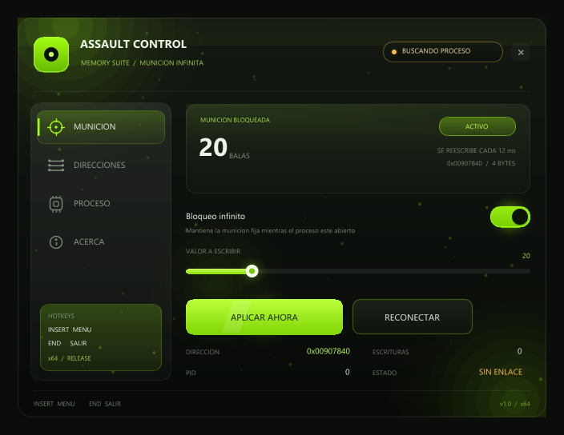

# ASSAULT CONTROL

**Comunidad / soporte:** https://discord.gg/CE8xPnpV6a

Overlay externo para **AssaultCube 1.3.0.2** que mantiene la munición fija en **20 balas** escribiendo directamente en la memoria del cliente, con un menú propio hecho en **Dear ImGui** con estética *glass* en verde lima.

- Binario: `x64/Release/CHEAT ASSAULT.exe`
- Plataforma: **x64**, configuración **Release**, subsistema Windows (sin consola)
- Proceso objetivo: `ac_client.exe`
- Sin inyección de DLL: todo se hace desde un proceso externo con `WriteProcessMemory`



---

## Índice

1. [El encargo](#el-encargo)
2. [Cómo funciona](#cómo-funciona)
3. [Reconocimiento de la memoria](#reconocimiento-de-la-memoria)
4. [Arquitectura del programa](#arquitectura-del-programa)
5. [El overlay transparente](#el-overlay-transparente)
6. [La interfaz](#la-interfaz)
7. [El hilo escritor](#el-hilo-escritor)
8. [Estructura del proyecto](#estructura-del-proyecto)
9. [Compilar](#compilar)
10. [Uso](#uso)
11. [Problemas encontrados](#problemas-encontrados)
12. [Limitaciones](#limitaciones)
13. [Aviso](#aviso)

---

## El encargo

El punto de partida fue una tabla de Cheat Engine con dos entradas de 4 bytes apuntando al mismo contador de munición:

```xml
<CheatTable>
  <CheatEntries>
    <CheatEntry>
      <ID>0</ID>
      <VariableType>4 Bytes</VariableType>
      <Address>1886C89C</Address>
    </CheatEntry>
    <CheatEntry>
      <ID>1</ID>
      <VariableType>4 Bytes</VariableType>
      <Address>00907840</Address>
    </CheatEntry>
  </CheatEntries>
</CheatTable>
```

Los requisitos, tal cual se pidieron:

- Limpiar **todos los comentarios** del código de la solución.
- Modificar el valor de memoria de `C:\Program Files (x86)\AssaultCube 1.3.0.2\bin_win32\ac_client.exe` **mientras el proceso esté abierto**.
- Que la munición esté **siempre en 20 y nunca baje**.
- Compilar como **`.exe` x64**, nunca 32 bits, y en **modo Release**.
- Añadir un **menú ImGui** con diseño profesional tipo *glass*, color verde lima, botones exclusivos y efectos propios.

---

## Cómo funciona

El panel es un proceso **x64 independiente**. No inyecta ninguna DLL en el juego (el cliente es de 32 bits y una DLL x64 no podría cargarse ahí), así que el acceso se hace con las APIs de Windows:

| Paso | API | Para qué |
|------|-----|----------|
| 1 | `CreateToolhelp32Snapshot` + `Process32First/Next` | localizar el PID de `ac_client.exe` |
| 2 | `OpenProcess` con `SYNCHRONIZE \| PROCESS_VM_OPERATION \| PROCESS_VM_WRITE \| PROCESS_VM_READ \| PROCESS_QUERY_LIMITED_INFORMATION` | abrir el proceso |
| 3 | `ReadProcessMemory` | validar la dirección dinámica antes de tocarla |
| 4 | `WriteProcessMemory` | escribir el valor 20 cada 12 ms |
| 5 | `WaitForSingleObject(handle, 0)` | saber si el juego sigue vivo |

El valor se reescribe constantemente, así que aunque el juego reste una bala al disparar, el siguiente ciclo la devuelve a 20. Es un *freeze* clásico, sin parchear código ni tocar el ejecutable del juego.

---

## Reconocimiento de la memoria

Antes de escribir nada se comprobó qué había en cada dirección con un pequeño volcado (`ReadProcessMemory` + `VirtualQueryEx`):

```
addr=0x00907840 ok=1 val=20 region=0x00907000 state=0x1000 type=0x20000 protect=0x4
addr=0x1886C89C ok=1 val=20 region=0x1886C000 state=0x1000 type=0x20000 protect=0x4
```

Lecturas:

- Las dos direcciones contienen el mismo valor (**20**) → apuntan a la misma munición en dos sitios distintos.
- `state=0x1000` es `MEM_COMMIT` y `protect=0x4` es `PAGE_READWRITE`, o sea, memoria legible y escribible.
- `type=0x20000` es `MEM_PRIVATE`: **no** es la sección de datos del `.exe`, es memoria reservada en tiempo de ejecución (heap / `VirtualAlloc`).

Eso explica por qué la primera dirección se describía como “temporal”: al ser memoria privada, la `1886C89C` **cambia en cada arranque del juego**. La `00907840` se mantiene estable en esta versión del cliente.

De ahí salen los dos tipos de objetivo que maneja el panel:

| Tipo | Dirección | Comportamiento |
|------|-----------|----------------|
| **FIJA** | `0x00907840` | se escribe siempre |
| **DINÁMICA** | `0x1886C89C` | solo se escribe si antes se lee un valor coherente (0–999) |

Si el juego se reinicia y esa dirección pasa a apuntar a otra estructura, la escritura se descarta y el panel la marca como **dirección no válida** en lugar de corromper memoria ajena. El botón **REVALIDAR** vuelve a probarla.

---

## Arquitectura del programa

```
┌──────────────────────────────┐
│  CHEAT ASSAULT.exe (x64)     │
│                              │
│  main.cpp                    │  ventana + D3D11 + DirectComposition + bucle
│    └── ui.cpp                │  menú ImGui dibujado a mano
│    └── memory.cpp            │  hilo escritor (attach / write / reattach)
└──────────────┬───────────────┘
               │ WriteProcessMemory
               ▼
      ac_client.exe (32 bits)
        0x00907840  ← 20 cada 12 ms
        0x1886C89C  ← 20 si el valor leído es coherente
```

### Hilos

- **Hilo principal**: crea la ventana, el dispositivo D3D11, el swapchain de composición, inicializa ImGui y ejecuta el bucle de render a la frecuencia del monitor (`Present(1, 0)`).
- **Hilo escritor**: bucle independiente cada 12 ms. Si el juego no está abierto lo busca cada 600 ms; si se cierra, se desengancha y vuelve a esperar. Nunca bloquea la interfaz.

---

## El overlay transparente

El primer intento fue el truco clásico de DWM:

```cpp
MARGINS margins = { -1, -1, -1, -1 };
DwmExtendFrameIntoClientArea(hwnd, &margins);
```

Con un swapchain `DXGI_SWAP_EFFECT_DISCARD` y `ClearRenderTargetView` a `{0,0,0,0}`. **No funcionó**: la ventana se creaba, el proceso respondía y el bucle renderizaba, pero no se veía absolutamente nada en pantalla.

La solución fue **DirectComposition**, que da alfa por píxel real:

```cpp
desc.Format     = DXGI_FORMAT_B8G8R8A8_UNORM;
desc.SwapEffect = DXGI_SWAP_EFFECT_FLIP_SEQUENTIAL;
desc.AlphaMode  = DXGI_ALPHA_MODE_PREMULTIPLIED;
factory->CreateSwapChainForComposition(device, &desc, nullptr, &swapChain);

DCompositionCreateDevice(nullptr, __uuidof(IDCompositionDevice), &composition);
composition->CreateTargetForHwnd(hwnd, TRUE, &target);
composition->CreateVisual(&visual);
visual->SetContent(swapChain);
target->SetRoot(visual);
composition->Commit();
```

La ventana se crea con `WS_EX_NOREDIRECTIONBITMAP`, sin superficie de redirección, y el contenido se compone directamente.

El detalle que hace que los colores salgan bien: el backend DX11 de ImGui ya usa `SrcBlend = SRC_ALPHA`, `DestBlend = INV_SRC_ALPHA`, `SrcBlendAlpha = ONE`, `DestBlendAlpha = INV_SRC_ALPHA`, que produce exactamente **alfa premultiplicado** sobre un fondo transparente. Por eso `DXGI_ALPHA_MODE_PREMULTIPLIED` compone sin halos.

### Click-through

La ventana es `WS_EX_TOPMOST | WS_EX_TOOLWINDOW | WS_EX_NOACTIVATE` y cubre todo el escritorio virtual. Para no bloquear el ratón se responde a `WM_NCHITTEST`:

```cpp
if (!menuOpen) return HTTRANSPARENT;
return pointInsideMenu ? HTCLIENT : HTTRANSPARENT;
```

Es decir, solo el rectángulo del menú recibe clics; el resto del escritorio y el juego siguen funcionando con normalidad, incluso con el panel abierto.

---

## La interfaz

ImGui **1.91.8** vendorizado (solo backends `win32` + `dx11`), sin dependencias externas. Todo el estilo se dibuja a mano con `ImDrawList`, no se usan los widgets por defecto:

- **Panel glass**: degradado vertical con esquinas redondeadas calculadas píxel a píxel (inset por fila según la ecuación de la circunferencia), sombra suave por capas y doble borde interior.
- **Fondo vivo**: partículas de lima que suben y se reciclan, barrido de escaneo vertical, halo que sigue al cursor y dos glows de acento en las esquinas.
- **Botones**: degradado lima con brillo pulsante, banda de luz diagonal animada, elevación al pulsar, anillo de *ripple* al hacer clic y borde que se intensifica al pasar el ratón.
- **Toggle**: pastilla con knob animado por interpolación exponencial y glow cuando está activo.
- **Slider**: pista fina, relleno degradado, glow en el borde del relleno y knob con anillo.
- **Pestañas laterales**: iconos vectoriales dibujados con líneas y círculos (mira, capas, chip, información), barra de acento y transición de color.
- **Tipografía**: Segoe UI / Segoe UI Semibold / Segoe UI Bold cargadas del sistema, escaladas según el DPI del monitor.

Pestañas:

| Pestaña | Contenido |
|---------|-----------|
| **MUNICIÓN** | valor actual, bloqueo on/off, slider 1–100, aplicar, reconectar, dirección, escrituras, PID, estado |
| **DIRECCIONES** | lista de objetivos con tipo (FIJA / DINÁMICA), contador de escrituras por dirección, interruptor individual y validez |
| **PROCESO** | ejecutable, PID, dirección, método de escritura, reconectar, reaplicar valor |
| **ACERCA** | explicación del funcionamiento y datos de compilación |

---

## El hilo escritor

```cpp
while (running) {
    if (!attached)      attach();          // buscar PID + OpenProcess
    if (!alive)         detach();          // el juego se cerró
    if (lock)           writeAll();        // 12 ms por ciclo
    sleep(12ms);
}
```

`writeAll()` recorre los objetivos:

- **Fija**: escribe directamente.
- **Dinámica**: primero lee 4 bytes; si el valor está fuera de `0..999` la marca inválida y no escribe.
- Si una escritura falla en una dirección dinámica, solo se descarta esa dirección.
- Si falla en la fija, se cierra el handle y se vuelve a enganchar (el juego pudo reiniciarse).

---

## Estructura del proyecto

```
ASSAULTCUBE MENU/
├── CHEAT ASSAULT.slnx            solución (solo x64)
├── CHEAT ASSAULT.vcxproj         proyecto Release|x64
├── CHEAT ASSAULT.vcxproj.filters
├── src/
│   ├── main.cpp                  ventana, D3D11, DirectComposition, bucle
│   ├── memory.h / memory.cpp     hilo escritor y objetivos de memoria
│   └── ui.h / ui.cpp             menú ImGui y utilidades de dibujo
├── vendor/
│   └── imgui/                    Dear ImGui 1.91.8 (core + backends win32/dx11)
└── x64/Release/
    └── CHEAT ASSAULT.exe         binario compilado
```

El código propio no lleva **ni un comentario**, tal como se pidió; los nombres de funciones y variables son descriptivos a propósito.

---

## Compilar

### Visual Studio

1. Abrir `CHEAT ASSAULT.slnx`.
2. Selecciona **Release | x64** en la barra de herramientas. El proyecto incluye también **Debug | x64** para depurar.
3. `Compilar > Compilar solución`.

Salida: `x64/Release/CHEAT ASSAULT.exe`.

#### Si Visual Studio se queja al compilar

| Error | Causa | Solución |
|-------|-------|----------|
| `MSB8020` / no se encuentra el conjunto de herramientas `v145` | falta el componente de C++ | Instalador de Visual Studio → *Desarrollo para el escritorio con C++* |
| `MSB8036` / Windows SDK no encontrado | no hay SDK instalado | Instalador de Visual Studio → *Windows 10/11 SDK* |
| `MSB8013` / la combinación `Debug\|x64` no existe | configuración ausente en el proyecto | ya viene incluida en el `.vcxproj`; si persiste, borra la carpeta `.vs` y reabre |
| `LNK1104` no se puede abrir `x64\Release\CHEAT ASSAULT.exe` | el panel está abierto y bloquea el archivo | ciérralo con `END` y vuelve a compilar |
| `LNK2019` con `DCompositionCreateDevice` | falta `dcomp.lib` | ya está en las dependencias del proyecto y en el `#pragma comment` |

### Línea de comandos

```bat
msbuild "CHEAT ASSAULT.vcxproj" /p:Configuration=Release /p:Platform=x64
```

O directamente con el compilador:

```bat
cl /std:c++20 /EHsc /O2 /MD /utf-8 /DNDEBUG /DWIN32_LEAN_AND_MEAN /DNOMINMAX ^
   /Isrc /Ivendor\imgui /Ivendor\imgui\backends ^
   src\main.cpp src\memory.cpp src\ui.cpp ^
   vendor\imgui\imgui.cpp vendor\imgui\imgui_draw.cpp ^
   vendor\imgui\imgui_tables.cpp vendor\imgui\imgui_widgets.cpp ^
   vendor\imgui\backends\imgui_impl_dx11.cpp vendor\imgui\backends\imgui_impl_win32.cpp ^
   /link /SUBSYSTEM:WINDOWS d3d11.lib dcomp.lib dxgi.lib user32.lib gdi32.lib advapi32.lib
```

### Entorno con el que se compiló

| Elemento | Versión |
|----------|---------|
| Compilador | MSVC 19.51.36260 (toolset v145) |
| Windows SDK | 10.0.26100.0 |
| Estándar | C++20 |
| Runtime | `/MD` (necesita VC++ Redistributable) |
| ImGui | 1.91.8 |

---

## Uso

1. Abre **AssaultCube** (`ac_client.exe`).
2. Ejecuta `CHEAT ASSAULT.exe`.
3. El panel aparece centrado con la píldora de estado en verde y el PID del juego.

| Tecla | Acción |
|-------|--------|
| `INSERT` | mostrar / ocultar el menú |
| `END` | cerrar el programa |

En **MUNICIÓN** el bloqueo viene activo con valor 20. El slider permite entre 1 y 100; el cambio se aplica al instante. En **DIRECCIONES** puedes desactivar una dirección concreta o revalidarlas si reiniciaste el juego.

Arrastra el panel desde la cabecera para moverlo. La `X` superior derecha lo oculta (igual que `INSERT`).

---

## Problemas encontrados

| Síntoma | Causa | Solución |
|---------|-------|----------|
| La ventana no se veía, aunque el proceso funcionaba | `DwmExtendFrameIntoClientArea` no compone contenido D3D con alfa en este equipo | DirectComposition con `CreateSwapChainForComposition` y alfa premultiplicado |
| Encontraba el proceso pero no escribía: se enganchaba y se soltaba en bucle | `OpenProcess` sin el derecho `SYNCHRONIZE`, así que `WaitForSingleObject` devolvía `WAIT_FAILED` y el hilo creía que el juego había muerto | añadir `SYNCHRONIZE` a la máscara de acceso |
| El estado se quedaba siempre en “buscando” | el bucle sobrescribía el estado de error en cada iteración | el estado solo lo fija `Attach()`, no el bucle |
| Riesgo de escribir en memoria ajena tras reiniciar el juego | la dirección `0x1886C89C` es heap y cambia | lectura de comprobación previa (0–999) y marcado como inválida |
| El glow del botón principal invadía la tarjeta de arriba | radio de halo proporcional al ancho del botón | halo proporcional a la altura |

---

## Limitaciones

- Pensado para **AssaultCube 1.3.0.2** (`bin_win32`). Otra versión puede cambiar las direcciones.
- La dirección `0x00907840` se mantiene estable en esta build, pero no hay garantía entre versiones.
- La dirección dinámica solo se escribe mientras su contenido sea coherente; si el juego la reubica, hay que buscarla de nuevo en Cheat Engine.
- Si el juego se ejecuta **como administrador**, el panel también debe ejecutarse como administrador (si no, `OpenProcess` devuelve *acceso denegado*).
- El panel es externo: no lee estructuras del juego, solo escribe el contador. No hay ESP, aimbot ni nada por el estilo.
- Antivirus y anti-cheats pueden marcar aplicaciones que usan `WriteProcessMemory` sobre otro proceso. Es el comportamiento esperado de este tipo de herramienta.

---

## Aviso

Proyecto educativo sobre lectura y escritura de memoria de procesos en Windows, gestión de overlays con Direct3D 11 / DirectComposition y creación de interfaces con Dear ImGui. Úsalo solo en servidores propios o en modo offline. El uso en servidores públicos puede incumplir sus normas y provocar la expulsión.

**Discord:** https://discord.gg/CE8xPnpV6a
